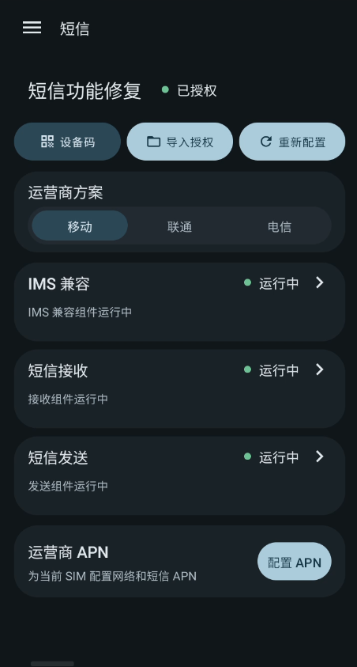

  

<h1 align="center">SCRMod</h1>

<strong>Advanced Control &amp; Diagnostics for Samsung SCR-01</strong>

SCRMod 基于 [SCRoot](https://github.com/hackintoanetwork/SCRoot) 提供的临时 Root 权限，为三星 SCR-01（Galaxy 5G Mobile Wi-Fi）扩展更多实用功能，包括热点信道设置、流量上限调整、蜂窝网络与小区信息分析，以及原设备未提供的短信收发支持。

目前主要适配 **SCR-01 / SM-H412J，Android 11，SCR01KDU1AVK2 固件**。应用针对横屏、竖屏及深色模式进行了界面优化，让不同使用场景下的操作和信息查看更加方便。

[下载发布版本](https://github.com/RedoRosetta/SCRMod/releases) · [使用说明](docs/GETTING_STARTED.md) · [Build58 更新记录](docs/RELEASE_BUILD58.md) · [问题反馈](https://github.com/RedoRosetta/SCRMod/issues/new/choose)

> 当前文档对应 SCRMod 1.0 Build58。GitHub 专版 APK 请从 Release 下载，公开源码范围见下文。

---

## 首页：常用功能集中管理

SCRMod 将网络、热点和短信功能集中在首页，方便快速查看各项功能的运行状态并进入对应设置。

首页还提供月度和三日流量上限的调整入口。相比原机设置，可以选择更高的额度，也能随时恢复默认值。应用后会读取设备实际生效的上限，而不是仅显示输入的数字。

流量上限只影响设备本地设置，不会改变 SIM 卡套餐额度或运营商限速规则。

  

## 热点：更灵活的 5 GHz 信道设置

在原有热点功能的基础上，SCRMod 增加了 5 GHz 信道选择，支持 36、40、44、48 等信道。

热点页面同时展示当前频率、信道和频宽，方便确认实际运行状态。也可以在设置中开启开机自动应用，减少每次启动后的重复操作。

不同固件和运行环境下，可用信道可能有所不同。应用信道时仍需满足设备及内核的安全检查条件。

  

## 网络：蜂窝设置与 NAT 诊断

网络页面提供蜂窝网络频段设置入口，并整合了 NAT 诊断功能。

通过 NAT 检测，可以查看当前网络出口的 NAT 类型及映射信息，帮助了解设备的网络连接环境，尤其适合排查远程访问或特定网络通信问题。

NAT 检测仅用于观察网络状态，不会直接改变运营商分配的 NAT 类型。

  

## 小区信息：更直观地观察信号

小区信息页面可以查看当前服务小区和附近搜索到的小区，支持 LTE / NR 网络信息展示。

除了频段、PCI 和信号强度，SCRMod 还使用信号条来直观比较邻近小区的信号强弱。专业参数默认保持简洁，需要时可以展开查看中文名称、英文名称及具体数值。

LTE RSRP 与 NR SS-RSRP 会分别标注测量类型。信号条采用 −140～−60 dBm 的参考刻度，不代表网络速度、信号质量百分比，也不意味着可以直接切换到信号最强的小区。

目前该功能主要用于观察和分析，暂不支持手动切换或锁定小区。

  

## 短信：补充原设备缺少的收发能力

SCRMod 为 SCR-01 补充了短信收发支持，针对中国移动、中国联通和中国电信提供对应的兼容方案。

短信页面集中展示授权状态、运营商方案，以及 IMS 兼容、短信接收和短信发送三个组件的运行情况。每个组件都有独立的状态提示，也可以进入详情查看，方便了解当前配置和定位异常。

应用还可以为当前 SIM 配置网络和短信 APN，并通过 IMS 兼容处理及短信发送、接收 Hook 实现相关功能。

  

短信功能依赖三星原生短信 APP，该 APP 并非本项目作者开发。GitHub 专版保留短信功能所需的客户端实现，但不附带三星短信 APP。如需使用，请联系作者了解兼容 APP 与授权方式。

短信兼容性受固件、SIM、运营商及短信 APP 版本影响。页面显示运行中仅代表软件组件状态，实际短信收发仍需要人工测试确认。

## 界面：横竖屏与深色模式

SCRMod 针对 SCR-01 的实际使用方式调整了整体界面，支持横屏、竖屏和深色模式。

横屏下，状态卡片与操作区域可以充分利用屏幕宽度，方便同时查看多项信息。切换到竖屏后，卡片和参数会重新排列，尽量保持文字、数值与操作按钮清晰可读。

深色模式采用统一的背景、卡片和控件配色，同时保留不同运行状态的视觉区分。无论是首页的网络状态、热点与短信入口，还是流量上限设置，都能在深色界面下保持清晰的层次。

  

小区信息和短信页面同样采用这一设计，信号条、组件状态与操作按钮都保持一致的视觉风格，不需要在不同页面之间重新适应操作方式。

## 设置：常用选项与诊断工具

设置页面集中管理开机自动应用、后台通知及其他应用选项，并提供统一的诊断日志入口。

遇到功能异常时，可以在这里查看或导出诊断信息，辅助判断设备和应用的运行情况。较长的诊断内容默认折叠，避免日常设置页面被大量技术信息占据。

设置页也沿用了统一的卡片布局和深色配色，让常用开关、说明文字和操作入口更容易区分。

  

---

## 下载与安装

1. 按照 [SCRoot](https://github.com/hackintoanetwork/SCRoot) 项目说明准备临时 Root 环境。
2. 从 [Build58 Release](https://github.com/RedoRosetta/SCRMod/releases/tag/v1.0-build58) 下载 GitHub 专版 APK，核对校验值后安装。源码压缩包不能直接安装。
3. 打开 SCRMod 并授予 Root 权限，按需调整热点、流量上限及网络设置。
4. 如需使用短信功能，请联系作者了解兼容应用与授权方式。不要在公开 Issue 中提交设备码或授权材料。

SCRMod 不包含三星短信 APP 或 Root 提权工具。设备重启后需重新确认 Root 是否可用；开机自动应用不会自行获取 Root。

遇到安装或授权异常时，请先保留错误提示，不要直接卸载或清除应用数据，以免丢失授权和本地记录。

详细步骤见 [安装与离线授权](docs/GETTING_STARTED.md)。

## 版本说明

### 1.0 Build58

Build58 主要优化了授权公钥的加载与复用，减少短信组件检查中的重复 Root 读取，并调整了热点页面的布局留白。

本版通过 59 项针对性测试。具体变化、安装包校验值及测试情况见 [Build58 更新记录](docs/RELEASE_BUILD58.md)。

当前本地完整功能版本尚未完成 GitHub 专版的设备安装与业务验收。历史版本曾出现换卡后发送失败、间歇性发送失败及接收失败等情况，Build58 尚不能确认这些问题在所有环境下均已解决。

目前主要适配 SCR-01 的 AVK2 固件，其他设备和固件暂不保证兼容。

## 源码与许可

仓库提供了经过审核的 Build58 部分功能源码。

短信、IMS、注入、授权及 APN 实现不在公开范围。**公开源码无法构建完整功能 APK**，部分界面也可能与上面展示的完整应用有所不同。

详细内容见 [源码范围](docs/SOURCE_SCOPE.md)。

自有代码目前尚未授予统一的开源许可证，第三方代码及组件遵循各自的许可证。

## 问题反馈

如果在使用 SCRMod 时遇到问题，欢迎通过 [GitHub Issues](https://github.com/RedoRosetta/SCRMod/issues/new/choose) 反馈。

请尽量说明应用版本、设备固件、操作步骤和遇到的现象。短信问题可以补充运营商、短信 APP 版本，以及发送和接收各自的测试结果。

请勿公开短信正文、号码、完整 PDU、设备码、授权文件、密钥或未经脱敏的原始日志。提交截图和诊断信息前请先检查，详见 [反馈说明](SECURITY.md)。

## 感谢 SCRoot

感谢 [SCRoot](https://github.com/hackintoanetwork/SCRoot) 项目及贡献者提供的 SCR-01 临时 Root 支持，这是 SCRMod 实现设备功能扩展的重要基础。

SCRMod 与 SCRoot 是两个独立项目。

## 支持开发

如果 SCRMod 对你有帮助，欢迎自愿支持后续开发。使用体验、测试反馈和改进建议，同样是对项目的支持。

<table align="center">
<tr><th>支付宝 Alipay</th><th>微信支付 WeChat Pay</th></tr>
<tr>
<td align="center"></td>
<td align="center"></td>
</tr>
</table>

无法使用这些支付方式也没有关系，欢迎通过反馈帮助改进。

---

<strong>SCRMod</strong> Advanced Control &amp; Diagnostics for Samsung SCR-01 Developed by <a href="https://github.com/RedoRosetta">RedoRosetta</a>

