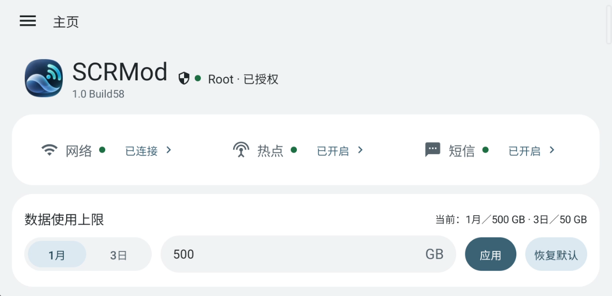
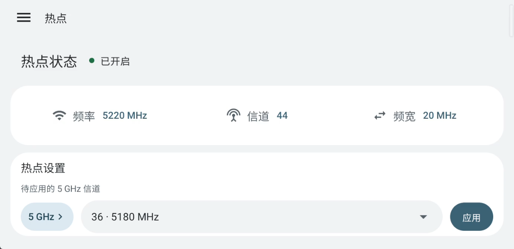
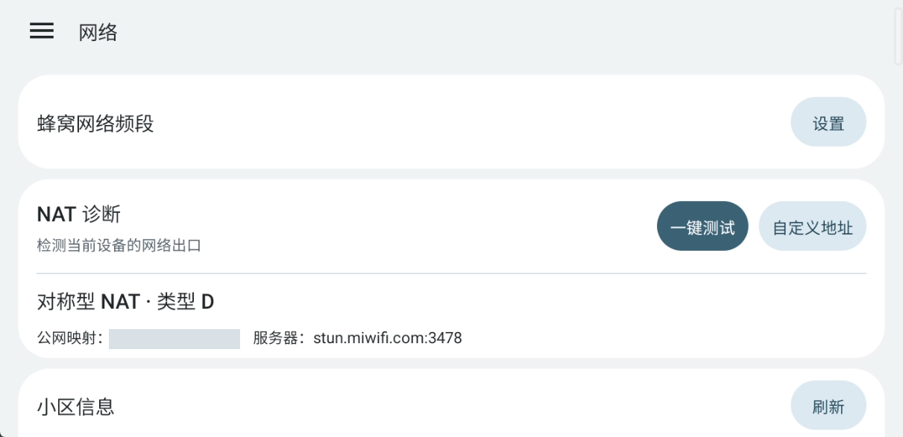
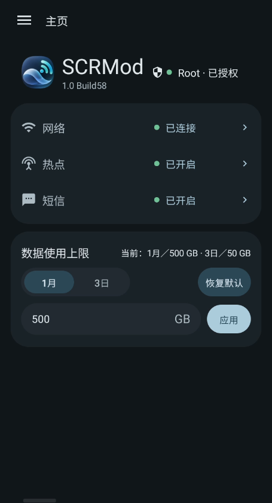
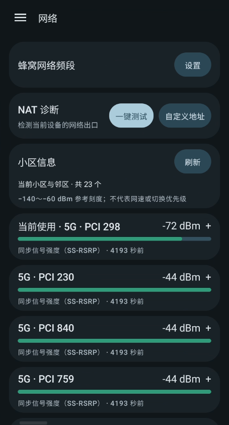
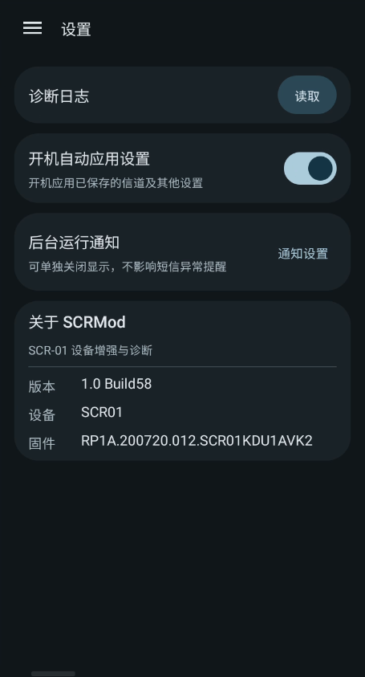

<h1 align="center">SCRMod</h1>

<strong>Advanced Control &amp; Diagnostics for Samsung SCR-01</strong>

SCRMod 建立在 [SCRoot](https://github.com/hackintoanetwork/SCRoot) 提供的临时 Root 权限基础上，为三星 SCR-01（Galaxy 5G Mobile Wi-Fi）扩充日常使用功能：扩展热点信道、提高设备流量上限，提供蜂窝网络快捷设置与频段、小区信息分析，并补充原设备未提供的短信收发功能。

目前主要适配 **SCR-01 / SM-H412J，Android 11，SCR01KDU1AVK2 固件**。同时针对横竖屏布局和深色模式做了适配，方便在不同使用方向与显示模式下查看和操作。

[发布页面](https://github.com/RedoRosetta/SCRMod/releases) · [使用说明](docs/GETTING_STARTED.md) · [Build58 更新记录](docs/RELEASE_BUILD58.md) · [问题反馈](https://github.com/RedoRosetta/SCRMod/issues/new/choose)

> 当前文档对应 1.0 Build58。GitHub 专版安装包见 Release，公开源码范围见下文。

  

## 选择 5 GHz 热点信道

在原有热点功能的基础上，增加 5 GHz 信道选择，支持 36、40、44、48 等信道。页面同时显示当前频率、信道和频宽，方便检查设置是否生效；也可以开启开机自动应用，减少重复设置。

不同固件和运行环境下，可用信道可能有所不同，应用时仍需满足设备与内核检查条件。

  

## 调整数据上限，分别管理两个周期

原机界面的流量上限设置不够灵活，SCRMod 提供更高额度的设置入口，可分别调整月度和三天两个周期，也能恢复默认值。首页显示设备实际读取到的上限，便于查看和修改。

这里修改的是设备本地的流量上限，不影响 SIM 卡套餐额度或运营商限速规则。

## 蜂窝网络设置与小区分析

提供蜂窝网络和频段设置的快捷入口，并将当前小区、邻区及信号信息集中展示。可以查看 LTE / NR、频段、PCI 和信号强度，展开了解更多参数，方便观察设备连接情况和比较信号变化。

小区信息目前用于查看与分析，不支持手动切换或锁定小区。

## 短信功能修复

为原设备补充短信收发支持，提供移动、联通、电信对应方案，包括为当前 SIM 自动写入网络与短信 APN、IMS 兼容处理，以及短信发送和接收 Hook。页面分别显示各组件状态，方便判断哪个环节需要处理。

短信功能依赖三星原生短信 APP，该 APP 并非本项目作者开发。GitHub 专版保留短信功能所需的客户端实现，但不附带三星短信 APP。如需使用短信功能，请联系作者了解兼容 APP 与授权方式。

短信兼容性受固件、SIM、运营商及短信 APP 版本影响。配置完成后仍需实际测试发送和接收，页面显示运行中并不等于收发一定正常。

## 界面适配

针对横屏、竖屏和深色模式调整了页面布局、文字对齐、卡片间距与颜色显示。横屏下集中展示状态和参数，竖屏下重新排列内容，减少文字拥挤，让首页、热点、网络和设置页面保持一致的使用体验。

## 诊断日志与 NAT 检测

设置页提供诊断信息的读取与导出，便于分析运行状态和排查故障。网络页提供 NAT 检测，可查看当前网络出口的 NAT 类型及映射信息，辅助判断连接环境。

### 网络检测、小区信息与深色主题

  

下方依次为深色主题的首页、小区信息和设置页面。

  
  
  

## 下载与安装

1. 先按 SCRoot 项目说明准备临时 Root 环境。
2. 从 [Build58 Release](https://github.com/RedoRosetta/SCRMod/releases/tag/v1.0-build58) 下载 GitHub 专版 APK 并核对校验值后安装。源码压缩包不能直接安装。
3. 打开 SCRMod 并授予 Root 权限，按需调整热点、流量上限及网络设置。
4. 短信功能的使用与授权方式，请联系作者确认。不要在公开 Issue 中提交设备码或授权材料。

SCRMod 不包含三星短信 APP 或 Root 提权工具。重启后需重新确认 Root 是否可用；开机自动应用不负责获取 Root。遇到安装或授权异常时，请先保留错误提示，不要直接卸载或清数据，以免丢失授权和本地记录。

详细步骤见[安装与离线授权](docs/GETTING_STARTED.md)。

## 版本说明

Build58 减少了重复的授权资源加载和短信组件状态读取，并调整了热点页面留白。具体变化、校验值与测试情况见[更新记录](docs/RELEASE_BUILD58.md)。

当前本地完整功能版本尚未完成专版设备安装与业务验收。历史版本出现过换卡后发送失败、间歇发送失败及接收失败，Build58 尚不能确认这些问题在所有环境下均已解决；其他设备和固件也未保证兼容。

## 源码与许可

仓库同步了 Sol 审核后的 Build58 部分功能源码。短信、IMS、注入、授权及 APN 实现不在公开范围。**公开源码无法构建完整功能 APK**，其界面也与上面的完整应用截图有所区别。[查看源码范围](docs/SOURCE_SCOPE.md)。

自有代码暂未授予统一开源许可证，第三方代码和组件遵循各自许可证。

## 问题反馈

请在 [Issues](https://github.com/RedoRosetta/SCRMod/issues/new/choose) 中说明应用版本、设备固件、操作步骤和遇到的现象。短信问题请补充运营商、短信 APP 版本，以及发送和接收各自的结果。

不要公开短信正文、号码、完整 PDU、设备码、授权文件、密钥或完整原始日志。截图和诊断信息请先检查并脱敏，详见[反馈说明](SECURITY.md)。

## 感谢 SCRoot

感谢 [SCRoot](https://github.com/hackintoanetwork/SCRoot) 项目及贡献者提供的 SCR-01 临时 Root 支持，这是 SCRMod 实现这些设备功能扩展的基础。两者为独立项目。

## 支持开发

如果 SCRMod 对你有帮助，欢迎自愿支持开发；使用、测试和反馈同样有价值。

<table align="center">
<tr><th>支付宝 Alipay</th><th>微信支付 WeChat Pay</th></tr>
<tr><td align="center"></td><td align="center"></td></tr>
</table>

无法使用这些支付方式也没有关系，欢迎通过反馈帮助改进。

---

<strong>SCRMod</strong> Advanced Control &amp; Diagnostics for Samsung SCR-01 Developed by <a href="https://github.com/RedoRosetta">RedoRosetta</a>

